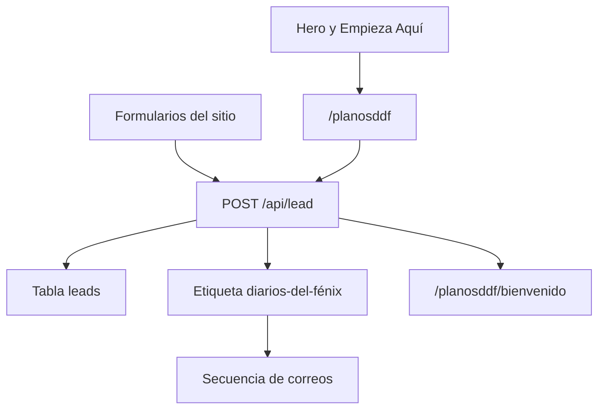
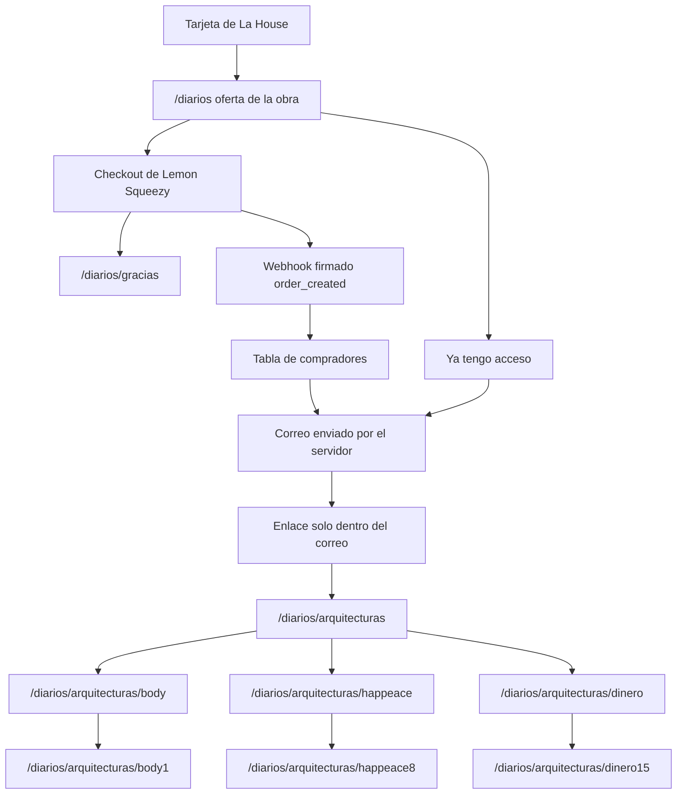
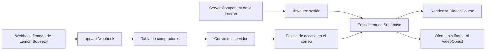

# Dos flujos: correos gratuitos y videos de pago

Diarios del Fénix nombra dos productos. Hoy comparten cookie, pantalla y la ruta `/diarios`. Cada uno queda con su propio árbol de links. En inglés el sitio antepone `/en`. En este árbol de correos, además, la palabra `planos` se traduce: `blueprints`. Un enlace de un árbol no apunta al otro.

## Antes de construir

Esta lista es tuya. No forma parte de los todos de implementación. La construcción empieza cuando estos puntos están hechos. Las claves se agregan en `.env.local` y no se pegan en el chat ni se commitean. Las claves de leads que ya existen se quedan como están: `SUPABASE_URL`, `SUPABASE_PUBLISHABLE_KEY`, `SUPABASE_SECRET_KEY` y `SYSTEME_API_KEY`.

Google Auth no hace falta, y tampoco un tercer proyecto de Supabase. Los dos proyectos gratuitos ya están ocupados. Los leads siguen en `leads` y en Systeme, con la etiqueta `diarios-del-fénix`. Los compradores no entran en Systeme: no se crea otra etiqueta ni otra base. Su lista queda en las tablas de Supabase y en la orden de Lemon Squeezy. El enlace de acceso lo firma el servidor y lo manda el propio sitio.

- [x] Dejar el proyecto actual de Supabase como está. Las tablas de compradores ya existen. Las claves `SUPABASE_URL` y `SUPABASE_SECRET_KEY` sirven para esas tablas y para `leads`.
- [x] No crear etiquetas ni una base de compradores en Systeme.
- [x] En Lemon Squeezy, crear la tienda y el producto del curso, primero en test mode. El precio y la moneda viven en esa variante. El precio visible del sitio tiene que coincidir con ella.
- [ ] Agregar en `.env.local`: `LEMONSQUEEZY_API_KEY`, `LEMONSQUEEZY_STORE_ID`, `LEMONSQUEEZY_VARIANT_ID` y `LEMONSQUEEZY_WEBHOOK_SECRET`.
- [ ] Agregar la clave del correo con el que el servidor enviará el acceso. Sin esa clave el webhook puede guardar la compra, y el mensaje a la bandeja no sale.
- [ ] En el recibo de Lemon Squeezy, no incluir el enlace a `/diarios/arquitecturas`. Ese enlace sale solo en el correo que envía el servidor.
- [ ] Confirmar que `SITE_URL` de producción es `https://iamfenix.com`, porque el retorno del checkout y el enlace del correo se arman con esa dirección.
- [ ] Cuando exista `/api/webhook`, registrar esa URL en Lemon Squeezy, con el secreto de firma, escuchando la orden creada. Hasta entonces no hay URL que pegar en el panel.

La tienda sigue en aprobación hasta el miércoles. Mientras no estén `LEMONSQUEEZY_API_KEY`, `LEMONSQUEEZY_STORE_ID`, `LEMONSQUEEZY_VARIANT_ID` y `LEMONSQUEEZY_WEBHOOK_SECRET`, no se abre un checkout real y no se registra el webhook. El resto del plan se construye ahora. La oferta muestra el precio y un estado quieto en el lugar del checkout. `/diarios/gracias`, las rutas del curso, la sesión del enlace y el corte de `/planosddf` no dependen de esas llaves. El correo de acceso se puede dejar escrito; se prueba cuando exista su clave. Las tablas no se vuelven a crear.

## 1. Lead magnet — secuencia de correos

Para quien deja nombre y correo en un formulario. El problema que resuelve es empezar la práctica gratuita. La acción es enviar el formulario. El resultado es entrar en la secuencia de correos que ya corre en Systeme.io. Funciona cuando el alta crea el lead, asigna la etiqueta y la persona llega a la confirmación de bandeja, sin que eso abra un video.

Árbol de links:

- `/planosddf` — entrada estable del lead magnet. La página contiene el formulario.
- `/planosddf/bienvenido` — confirmación de bandeja. `noindex`.
- `/en/blueprintsddf` y `/en/blueprintsddf/bienvenido` — la misma lectura en inglés.

`/planosddf` y `/en/blueprintsddf` son el mismo recurso en dos idiomas, unidos por `hreflang`. `localizeHref` hoy solo antepone `/en` y dejaría `/en/planosddf`. Este árbol necesita un mapa propio de ruta por idioma. `/en/planosddf` redirige a `/en/blueprintsddf`.



Enlaces que pasan a este árbol:

- El hero, en [components/hero/Hero.js](components/hero/Hero.js), hoy va a `/diarios`. Pasa a `/planosddf` en español y a `/en/blueprintsddf` en inglés.
- «Empieza Aquí», en [content/navigation/main.js](content/navigation/main.js), hoy va a `/diarios`. Pasa a esas mismas rutas.
- El formulario del cierre de la home y el del perfil de La House siguen donde están. Su destino de éxito, hoy `/diarios/bienvenido` en [components/forms/DiariosLeadForm.js](components/forms/DiariosLeadForm.js), pasa a `/planosddf/bienvenido` o a `/en/blueprintsddf/bienvenido`, según el idioma.

Piezas de este flujo:

- [app/api/lead/route.js](app/api/lead/route.js) escribe `leads` y llama a Systeme.
- La confirmación que hoy está en [content/diarios/confirmation.js](content/diarios/confirmation.js) y en `app/[locale]/diarios/bienvenido/` se muda a este árbol. El copy sigue hablando de la bandeja, de las 3 semanas y del acceso gratuito.
- `/diarios/bienvenido` redirige a `/planosddf/bienvenido`, y `/en/diarios/bienvenido` a `/en/blueprintsddf/bienvenido`.

Este árbol no enlaza a `/diarios`, ni a las arquitecturas, ni al reproductor. El formulario deja de llamar a `grantDiariosAccess()`. La cookie `fenix-diarios` deja de existir como permiso.

## 2. Obra de pago — secuencia de videos

Para quien elige la obra en La House. El problema es entrar a los 21 videos de las tres arquitecturas. La acción es pagar una vez. El resultado es elegir arquitectura y ver el día. Funciona cuando el iframe se renderiza solo si el servidor reconoce la compra.

Árbol de links. El día deja de viajar en `?dia=` y pasa a ser parte de la ruta. El número es el día que ya existe en el curso, del 1 al 21. En inglés se antepone `/en` y el resto de la ruta se mantiene.

- `/diarios` — la oferta. Después de la compra y de la confirmación del pago, se abren las tres puertas.
- `/diarios/arquitecturas` — la página de las tres cards.
- `/diarios/arquitecturas/body`, `/diarios/arquitecturas/happeace`, `/diarios/arquitecturas/dinero` — cada arquitectura.
- `/diarios/arquitecturas/body1` … `body7` — Body Architecture™.
- `/diarios/arquitecturas/happeace8` … `happeace14` — Happeace Architecture™.
- `/diarios/arquitecturas/dinero15` … `dinero21` — Money Architecture™.

Los videos siguen definidos en [content/diarios/courses.js](content/diarios/courses.js). Hoy el href de una práctica es `/body?dia=1`. Pasa a `/diarios/arquitecturas/body1`.

Las rutas viejas redirigen al día que ya pedían:

- `/body` → `/diarios/arquitecturas/body`
- `/body?dia=1` → `/diarios/arquitecturas/body1`
- `/happeace?dia=8` → `/diarios/arquitecturas/happeace8`
- `/dinero?dia=15` → `/diarios/arquitecturas/dinero15`

Enlaces que pertenecen a este árbol:

- La tarjeta de La House, `diarios-del-fenix` en [content/works/works.js](content/works/works.js), sigue en `/diarios`.
- «Diarios del Fénix» en la bienvenida de The Atelier, en [content/services/tiers.js](content/services/tiers.js), sigue en `/diarios`. Es un destino de la obra, no del formulario.



`/diarios` no muestra el formulario del lead magnet, no enlaza a `/planosddf` y no enlaza a `/diarios/arquitecturas`. Sin compra muestra la oferta: qué es, las tres arquitecturas, la inversión una sola vez, y el checkout de Lemon Squeezy. Al volver de ese checkout, la persona llega a `/diarios/gracias`. En inglés, `/en/diarios/gracias`.

`/diarios/gracias` agradece la compra y dice que el acceso va en camino a la bandeja: revisar el correo y seguir las instrucciones que abren el producto. Esa página no contiene el enlace a `/diarios/arquitecturas`, ni las cards, ni el video. Es `noindex`.

El enlace que abre el curso existe solo en el correo que envía el servidor. Ese enlace inicia la sesión y deja a la persona en `/diarios/arquitecturas`. Quien ya compró y pide el acceso de nuevo recibe otra vez ese correo; la oferta tampoco le muestra la ruta. Systeme no participa en este envío.

En `/diarios/arquitecturas` viven las tres cards que hoy están en [components/sections/DiariosWelcome.js](components/sections/DiariosWelcome.js). Cada card entra a su arquitectura, y cada arquitectura enlaza sus días: `body1` a `body7`, `happeace8` a `happeace14`, `dinero15` a `dinero21`. El video se reproduce solo en la ruta del día. Sin la sesión que abre el correo, `/diarios/arquitecturas` y todo lo que cuelga de ella vuelven a la oferta, sin iframe.

El correo del comprador lo confirma Lemon Squeezy en la orden. No es el formulario del lead magnet, no llama a `/api/lead` y no se escribe en `leads`.

Las reglas nombran Stripe en `libs/stripe.js` y `app/api/stripe`. Esta fase no los implementa: esos archivos siguen vacíos. Lemon Squeezy ocupa su lugar, en un módulo propio y en `app/api/webhook`, llamando a su API con `fetch`. No hace falta una librería nueva.

Estados de la obra, en voz calma y con una siguiente acción:

- **idle** — la oferta pública, con el checkout de Lemon Squeezy.
- **loading / processing** — el pago está en Lemon Squeezy, a la espera del webhook. Los videos siguen cerrados hasta que ese aviso llega firmado.
- **success** — `/diarios/gracias`. El curso se abre después, desde el correo.
- **unauthorized** — un día sin la sesión del correo: volver a la oferta y pedir de nuevo el correo. La página no revela la ruta.
- **forbidden** — hay sesión y no hay compra: volver a la oferta, sin iframe.
- **error** — el pago o el enlace no se completó, y cómo reintentar.
- **empty** — un día sin `youtubeId`.

## Frontera entre los dos

- **Lead** vive en la tabla `leads` del Supabase actual y en la base de Systeme de `/planosddf`, con la etiqueta `diarios-del-fénix`. Esa base dispara la secuencia gratuita.
- **Comprador** vive en las tablas que ya existen (`buyers`, `buyer_orders`, `buyer_webhook_events`) y en la orden de Lemon Squeezy. El servidor lee esa compra y envía el enlace a `/diarios/arquitecturas`. `systeme_contact_id` queda vacío.
- El webhook de Lemon Squeezy escribe solo en esas tablas. No llama a Systeme. `/api/lead` no escribe en esas tablas. La compra no usa la etiqueta `diarios-del-fénix` ni apaga la secuencia de `/planosddf`.
- Un mismo correo puede estar en las dos tablas. Estar en `leads` no abre el curso. Comprar el curso no sustituye el alta del formulario.
- El precio que se cobra es el de la variante de Lemon Squeezy. El precio visible vive en `content/diarios/` y coincide con esa variante. El servidor solo abre el curso si el webhook trae el `LEMONSQUEEZY_VARIANT_ID` esperado.
- El video sigue en YouTube. La página no se renderiza sin entitlement. Un hosting privado sería otra fase.
- `/dashboard` no participa. La superficie privada de los videos es el árbol `/diarios`.
- El precio se muestra con el mismo peso que el resto del texto. El checkout se nombra sin lenguaje de urgencia.

## Tablas de compradores

Van en el mismo proyecto donde ya está `public.leads`. No se abre otro proyecto y no se modifica `leads`. El comentario del SQL que decía «proyecto nuevo» y el `provider` limitado a PayPal y Wise no aplican: el cobro es Lemon Squeezy, y la fila nace cuando el webhook confirma la orden, no cuando alguien abre el checkout.

Tres tablas alcanzan. `buyers` es la persona. `buyer_orders` es la orden pagada o reembolsada, y también el estado del correo de acceso. `buyer_webhook_events` evita procesar dos veces el mismo aviso. El acceso existe cuando hay una orden `paid` de `diarios_del_fenix` con `revoked_at` vacío. El enlace del correo guarda solo el hash del token.

```sql
create extension if not exists pgcrypto;

create table if not exists public.buyers (
  id uuid primary key default gen_random_uuid(),
  email text not null,
  full_name text,
  systeme_contact_id text,
  access_token_hash text,
  created_at timestamptz not null default now(),
  updated_at timestamptz not null default now()
);

create unique index if not exists buyers_email_unique
  on public.buyers (lower(trim(email)));

create table if not exists public.buyer_orders (
  id uuid primary key default gen_random_uuid(),
  buyer_id uuid not null references public.buyers (id),
  provider text not null default 'lemonsqueezy'
    check (provider = 'lemonsqueezy'),
  provider_order_id text not null,
  variant_id text not null,
  product_code text not null default 'diarios_del_fenix',
  amount_minor bigint not null check (amount_minor > 0),
  currency text not null check (currency ~ '^[A-Z]{3}$'),
  status text not null check (status in ('paid', 'refunded')),
  email_status text not null default 'pending'
    check (email_status in ('pending', 'sent', 'failed')),
  email_attempts integer not null default 0,
  email_last_error text,
  email_sent_at timestamptz,
  revoked_at timestamptz,
  created_at timestamptz not null default now(),
  updated_at timestamptz not null default now(),
  unique (provider, provider_order_id)
);

create index if not exists buyer_orders_buyer_id_idx
  on public.buyer_orders (buyer_id);

create table if not exists public.buyer_webhook_events (
  id uuid primary key default gen_random_uuid(),
  provider text not null default 'lemonsqueezy'
    check (provider = 'lemonsqueezy'),
  event_id text not null,
  event_type text,
  processed_at timestamptz,
  created_at timestamptz not null default now(),
  unique (provider, event_id)
);

alter table public.buyers enable row level security;
alter table public.buyer_orders enable row level security;
alter table public.buyer_webhook_events enable row level security;
```

RLS queda activo y sin políticas públicas. Solo el servidor entra, con `SUPABASE_SECRET_KEY`. Estas tablas ya están creadas. La construcción las usa y no las vuelve a crear. Si el `provider` de `buyer_orders` todavía solo acepta PayPal o Wise, el check pasa a aceptar `lemonsqueezy`.

## Recorrido del sistema, solo videos



- La sesión y la compra se deciden en el servidor. La cookie actual se escribe en el cliente.
- Lemon Squeezy cobra y después avisa al sitio. El servidor verifica la firma del webhook, procesa cada orden una sola vez, escribe al comprador en su tabla y envía el correo de acceso. Una orden reembolsada cierra ese acceso.
- El correo sale de [libs/email.js](libs/email.js). El enlace no se imprime en `/diarios` ni en `/diarios/gracias`. `email_status` en `buyer_orders` recuerda si ese envío quedó pendiente, enviado o fallido.
- Volver del checkout lleva a `/diarios/gracias`. No concede el video. Un botón de «ya pagué» tampoco. El webhook firmado es lo que dispara el correo, y el enlace de ese correo es lo que abre `/diarios/arquitecturas`.
- [components/sections/DiariosCoursePage.js](components/sections/DiariosCoursePage.js) hoy publica el embed y el `VideoObject` sin puerta. [app/sitemap.js](app/sitemap.js) indexa `/diarios`, `/body`, `/happeace` y `/dinero` como si fueran una sola superficie.
- La identidad del comprador vive en `libs/auth.js` y `app/api/auth`. El webhook de Lemon Squeezy vive en `app/api/webhook`, y desde ahí se escribe la tabla de compradores con el mismo cliente de [lib/supabase-server.js](lib/supabase-server.js). `libs/stripe.js` y `app/api/stripe` quedan sin implementar.

## Superficies

- **Correos.** `/planosddf` y `/en/blueprintsddf` son públicos e indexables, con canonical y `hreflang` cruzados. `/planosddf/bienvenido` y `/en/blueprintsddf/bienvenido` son `noindex` y quedan fuera del sitemap.
- **Oferta, `/diarios`.** Pública e indexable. Intención transaccional. Un H1. Schema `Course` anidado en Fénix. Precio visible. Sin videos, sin las tres cards y sin enlace a `/diarios/arquitecturas`.
- **Gracias, `/diarios/gracias`.** `noindex`. Agradece la compra y remite a la bandeja. Sin enlace al curso.
- **Curso, bajo `/diarios/arquitecturas`.** La entrada llega desde el correo. La página de las tres cards, cada arquitectura y cada día (`body1`, `happeace8`, `dinero15`) son `noindex` y quedan fuera del sitemap. El breadcrumb del día vuelve a su arquitectura, luego a `/diarios/arquitecturas` y a `/diarios`. Nunca a `/planosddf` ni a `/en/blueprintsddf`.

## Orden de trabajo

Ahora, sin las llaves de Lemon Squeezy:

1. **Corte de links.** Nacen `/planosddf`, `/planosddf/bienvenido`, `/en/blueprintsddf` y `/en/blueprintsddf/bienvenido`. Hero, «Empieza Aquí» y el éxito del formulario apuntan al par según el idioma. `/diarios` deja de mostrar `CTADiariosFenix` y se queda en la oferta. Las tres cards pasan a `/diarios/arquitecturas`, cada arquitectura a su ruta y cada día a `body1`, `happeace8`, `dinero15` y las que siguen. `/body?dia=1` y sus equivalentes redirigen a esas rutas. `/diarios/bienvenido` redirige al árbol de correos.
2. **Oferta canónica** de la secuencia de videos en `content/diarios/`, consumida por la tarjeta y por `/diarios`. El lugar del checkout permanece quieto hasta que existan las llaves.
3. **Tablas** `buyers`, `buyer_orders` y `buyer_webhook_events`, ya creadas. Confirmar que aceptan `lemonsqueezy`. No hay alta de compradores en Systeme.
4. **`/diarios/gracias`.** La página agradece y pide revisar la bandeja, sin el enlace del curso. Todavía no llega tráfico desde un checkout real.
5. **Puerta de las lecciones.** El enlace firma una sesión y abre `/diarios/arquitecturas`. Sin esa sesión no hay iframe ni schema de video. La cookie del formulario deja de conceder acceso.
6. **Descubrimiento.** El sitemap lista `/planosddf`, `/en/blueprintsddf` y `/diarios`, cada uno con su canonical. El par de correos lleva `hreflang`. `/planosddf/bienvenido`, `/diarios/gracias`, `/diarios/arquitecturas` y cada día quedan fuera. El schema `Course` solo se publica en `/diarios`.
7. **Correo del curso.** El envío queda escrito en el servidor. Se prueba cuando la clave de correo esté en `.env.local`.

Cuando la tienda esté aprobada y las cuatro llaves estén en `.env.local`:

8. **Pago.** La oferta abre el checkout de Lemon Squeezy. El retorno llega a `/diarios/gracias`. El webhook firmado escribe la compra solo si la variante es la del curso, y entonces el servidor envía el correo. La URL `/api/webhook` se registra en el panel.

Medición separada. En el lead magnet: `lead_completed`. En la obra: `checkout_started` con el proveedor, `purchase_completed` y apertura de la primera lección.