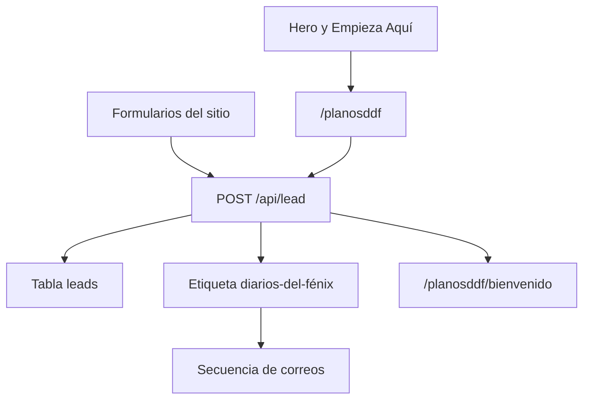
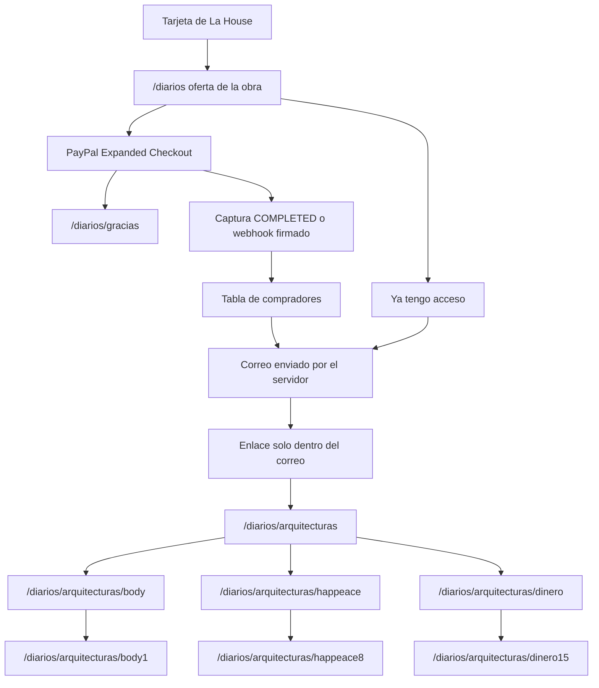
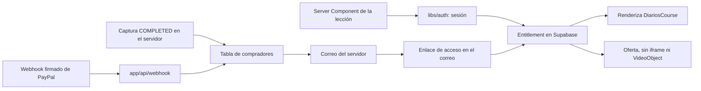
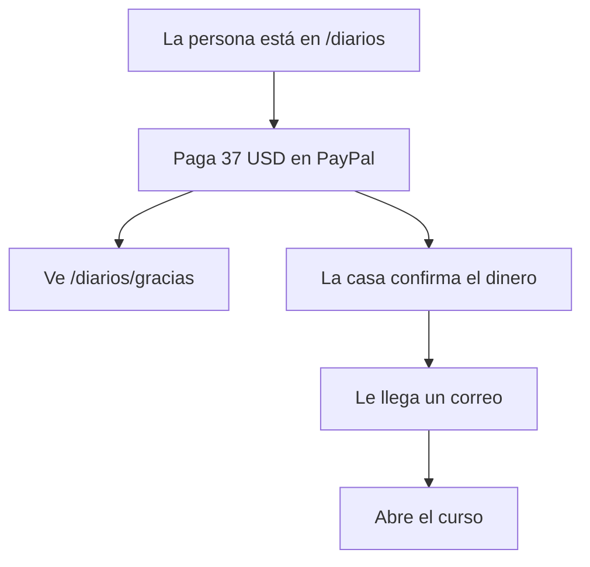

# Dos flujos: correos gratuitos y videos de pago

Diarios del Fénix nombra dos productos. Hoy comparten cookie, pantalla y la ruta `/diarios`. Cada uno queda con su propio árbol de links. En inglés el sitio antepone `/en`. En este árbol de correos, además, la palabra `planos` se traduce: `blueprints`. Un enlace de un árbol no apunta al otro.

## Antes de abrir el checkout

Los dos árboles ya están construidos. Esta lista es lo que falta para que PayPal cobre. No forma parte de los todos de implementación. Las claves se agregan en `.env.local` y no se pegan en el chat ni se commitean. Las claves de leads que ya existen se quedan como están: `SUPABASE_URL`, `SUPABASE_PUBLISHABLE_KEY`, `SUPABASE_SECRET_KEY` y `SYSTEME_API_KEY`. Las variables `LEMONSQUEEZY_*` no se usan.

Google Auth no hace falta, y tampoco un tercer proyecto de Supabase. Los dos proyectos gratuitos ya están ocupados. Los leads siguen en `leads` y en Systeme, con la etiqueta `diarios-del-fénix`. Los compradores no entran en Systeme: no se crea otra etiqueta ni otra base. Su lista queda en las tablas de Supabase y en la orden de PayPal. El enlace de acceso lo firma el servidor y lo manda el propio sitio.

PayPal nombra este cobro Expanded Checkout: el botón de PayPal y los campos de tarjeta viven en `/diarios`. La integración nueva usa JavaScript SDK v6, cargado desde el dominio de PayPal, y Orders API v2. No hace falta un paquete npm.

- [x] Dejar el proyecto actual de Supabase como está. Las tablas de compradores ya existen. Las claves `SUPABASE_URL` y `SUPABASE_SECRET_KEY` sirven para esas tablas y para `leads`.
- [x] No crear etiquetas ni una base de compradores en Systeme.
- [ ] Cuenta PayPal Business que pueda recibir 37 USD. Primero la app de sandbox en el panel de desarrolladores. Ahí se activa Expanded Checkout, los campos de tarjeta. Si PayPal todavía no habilita las tarjetas, el sitio muestra solo el botón de PayPal.
- [ ] Agregar en `.env.local`: `PAYPAL_CLIENT_ID`, `PAYPAL_CLIENT_SECRET`, `PAYPAL_WEBHOOK_ID` y `PAYPAL_ENV`. `PAYPAL_ENV` vale `sandbox` hasta la prueba real, y después `live`.
- [ ] Agregar las llaves de Namecheap Private Email en `.env.local`. No se abre cuenta en Resend. Sin esas llaves la compra puede guardarse, y el mensaje a la bandeja no sale.
- [ ] En la nota o el recibo de PayPal, no incluir el enlace a `/diarios/arquitecturas`. Ese enlace sale solo en el correo que envía el servidor.
- [ ] Confirmar que `SITE_URL` de producción es `https://iamfenix.com`, porque el retorno del checkout y el enlace del correo se arman con esa dirección.
- [ ] Cuando el webhook esté listo, registrar `https://iamfenix.com/api/webhook` en PayPal para `PAYMENT.CAPTURE.COMPLETED`, `PAYMENT.CAPTURE.REFUNDED` y `PAYMENT.CAPTURE.REVERSED`.
- [ ] En Supabase, el `check` de `provider` en `buyer_orders` y `buyer_webhook_events` tiene que aceptar `paypal`. No se crean tablas nuevas. Si el check quedó en `lemonsqueezy`, se cambia a `paypal`.

Mientras falten `PAYPAL_CLIENT_ID`, `PAYPAL_CLIENT_SECRET` y `PAYPAL_WEBHOOK_ID`, `/diarios` sigue como ahora: la oferta editorial, con el precio al final y sin botón de pago. `/diarios/gracias`, las rutas del curso, la sesión del enlace y `/planosddf` no dependen de esas llaves.

## 1. Lead magnet — secuencia de correos

Para quien deja nombre y correo en un formulario. El problema que resuelve es empezar la práctica gratuita. La acción es enviar el formulario. El resultado es entrar en la secuencia de correos que ya corre en Systeme.io. Funciona cuando el alta crea el lead, asigna la etiqueta y la persona llega a la confirmación de bandeja, sin que eso abra un video.

Árbol de links:

- `/planosddf` — entrada estable del lead magnet. La página contiene el formulario.
- `/planosddf/bienvenido` — confirmación de bandeja. `noindex`.
- `/en/blueprintsddf` y `/en/blueprintsddf/bienvenido` — la misma lectura en inglés.

`/planosddf` y `/en/blueprintsddf` son el mismo recurso en dos idiomas, unidos por `hreflang`. `localizeHref` hoy solo antepone `/en` y dejaría `/en/planosddf`. Este árbol necesita un mapa propio de ruta por idioma. `/en/planosddf` redirige a `/en/blueprintsddf`.



Enlaces que pasan a este árbol:

- El hero, en [components/hero/Hero.js](components/hero/Hero.js), hoy va a `/diarios`. Pasa a `/planosddf` en español y a `/en/blueprintsddf` en inglés.
- «Empieza Aquí», en [content/navigation/main.js](content/navigation/main.js), hoy va a `/diarios`. Pasa a esas mismas rutas.
- El formulario del cierre de la home y el del perfil de La House siguen donde están. Su destino de éxito, hoy `/diarios/bienvenido` en [components/forms/DiariosLeadForm.js](components/forms/DiariosLeadForm.js), pasa a `/planosddf/bienvenido` o a `/en/blueprintsddf/bienvenido`, según el idioma.

Piezas de este flujo:

- [app/api/lead/route.js](app/api/lead/route.js) escribe `leads` y llama a Systeme.
- La confirmación que hoy está en [content/diarios/confirmation.js](content/diarios/confirmation.js) y en `app/[locale]/diarios/bienvenido/` se muda a este árbol. El copy sigue hablando de la bandeja, de las 3 semanas y del acceso gratuito.
- `/diarios/bienvenido` redirige a `/planosddf/bienvenido`, y `/en/diarios/bienvenido` a `/en/blueprintsddf/bienvenido`.

Este árbol no enlaza a `/diarios`, ni a las arquitecturas, ni al reproductor. El formulario deja de llamar a `grantDiariosAccess()`. La cookie `fenix-diarios` deja de existir como permiso.

## 2. Obra de pago — secuencia de videos

Para quien elige la obra en La House. El problema es entrar a los 21 videos de las tres arquitecturas. La acción es pagar una vez. El resultado es elegir arquitectura y ver el día. Funciona cuando el iframe se renderiza solo si el servidor reconoce la compra.

Árbol de links. El día deja de viajar en `?dia=` y pasa a ser parte de la ruta. El número es el día que ya existe en el curso, del 1 al 21. En inglés se antepone `/en` y el resto de la ruta se mantiene.

- `/diarios` — la oferta. Después de la compra y de la confirmación del pago, se abren las tres puertas.
- `/diarios/arquitecturas` — la página de las tres cards.
- `/diarios/arquitecturas/body`, `/diarios/arquitecturas/happeace`, `/diarios/arquitecturas/dinero` — cada arquitectura.
- `/diarios/arquitecturas/body1` … `body7` — Body Architecture™.
- `/diarios/arquitecturas/happeace8` … `happeace14` — Happeace Architecture™.
- `/diarios/arquitecturas/dinero15` … `dinero21` — Money Architecture™.

Los videos siguen definidos en [content/diarios/courses.js](content/diarios/courses.js). Hoy el href de una práctica es `/body?dia=1`. Pasa a `/diarios/arquitecturas/body1`.

Las rutas viejas redirigen al día que ya pedían:

- `/body` → `/diarios/arquitecturas/body`
- `/body?dia=1` → `/diarios/arquitecturas/body1`
- `/happeace?dia=8` → `/diarios/arquitecturas/happeace8`
- `/dinero?dia=15` → `/diarios/arquitecturas/dinero15`

Enlaces que pertenecen a este árbol:

- La tarjeta de La House, `diarios-del-fenix` en [content/works/works.js](content/works/works.js), sigue en `/diarios`.
- «Diarios del Fénix» en la bienvenida de The Atelier, en [content/services/tiers.js](content/services/tiers.js), sigue en `/diarios`. Es un destino de la obra, no del formulario.



`/diarios` no muestra el formulario del lead magnet, no enlaza a `/planosddf` y no enlaza a `/diarios/arquitecturas`. Sin compra muestra la oferta editorial: el título, las tres arquitecturas y, al final de la lectura, la inversión de 37 USD. Cuando existan las llaves, debajo del precio aparecen el botón de PayPal y los campos de tarjeta. Al volver de ese pago, la persona llega a `/diarios/gracias`. En inglés, `/en/diarios/gracias`.

`/diarios/gracias` agradece la compra y dice que el acceso va en camino a la bandeja: revisar el correo y seguir las instrucciones que abren el producto. Esa página no contiene el enlace a `/diarios/arquitecturas`, ni las cards, ni el video. Es `noindex`.

El enlace que abre el curso existe solo en el correo que envía el servidor. Abrirlo no lo gasta. Deja una sesión en ese navegador, por un año, y el mismo mensaje se puede abrir otra vez en otro dispositivo. Systeme no participa en este envío.

Volver a entrar no pide Google, contraseña ni `/dashboard`. Hay dos puertas, y las dos llegan al mismo correo de compra:

- El último correo sigue siendo válido. Abrirlo de nuevo escribe la sesión y deja a la persona en `/diarios/arquitecturas`.
- En `/diarios`, después del precio, un campo «Ya tengo acceso» pide el correo. Si esa dirección tiene una compra vigente, el servidor manda otro enlace. La respuesta es la misma si el correo no compró, para no revelar quién está en la lista. La página no muestra la ruta del curso.

Pedir otro enlace reemplaza al anterior. El mensaje nuevo es el que abre la sesión. El anterior deja de servir, y el navegador donde ya estaba abierta se renueva al usar el nuevo. Un reembolso cierra las dos puertas.

## Longevidad de este cobro

Este plan es el adecuado para Diarios del Fénix a 37 USD. No se cambia a Google, Clerk, Auth0, un dashboard ni un segundo proyecto de Supabase.

Escala. Miles de compradores caben en las tres tablas actuales y en el cliente de servidor. El cuello no es la base: es el correo que no sale y la persona que paga con un correo de PayPal y luego pide el acceso con otro. Eso se resuelve reenviando al correo de la orden, no con otra infraestructura.

Seguridad de esta fase. El servidor es quien cobra, quien escribe la compra y quien abre el iframe. La tarjeta no pasa por el sitio. El token se guarda en hash. El webhook se verifica. La página no publica la ruta del curso. El enlace del correo no se gasta al primer clic, para que sirva en otro dispositivo; pedir otro enlace sí apaga el anterior. El token no se escribe en logs. YouTube no es un candado: el iframe solo se pinta con sesión, y el id del video sigue en el HTML. Para una obra de este precio eso es suficiente. Un hosting privado sería otra fase, si alguien empieza a reenviar los videos.

Qué no se construye ahora. Contraseña, Google, `/dashboard` y una tabla de sesiones por dispositivo. Esas piezas aparecen el día en que haya varias obras pagas, una suscripción o un acceso en equipo. Hasta entonces el correo de la compra es la identidad.

Qué se endurece en esta misma fase, sin cambiar el flujo:

- El enlace del correo caduca a los 90 días. La cookie del navegador dura un año. Quien llega tarde pide otro enlace en `/diarios`.
- El callback quita el token de la barra al escribir la cookie.
- Si el correo de PayPal y el que la persona recuerda no coinciden, el reenvío usa el correo de la orden. No se inventa una cuenta.

## Riesgo: alguien que entra, y las plataformas

Este protocolo no es un candado militar. Es el de una obra digital de 37 USD. Eso basta si las llaves no salen del servidor.

Quien intenta entrar sin pagar no ve los videos: la ruta no se publica, la sesión se decide en el servidor y adivinar el enlace no abre el iframe. Quien paga y luego pide reembolso pierde el acceso cuando PayPal avisa. Quien reenvía el correo reenvía la puerta, hasta que se pide otro enlace. Quien abre el HTML de una lección ve el id de YouTube: eso no le da la lista de compradores. La tarjeta nunca pasa por i.am.

El peligro real no es un extraño adivinando URLs. Es una llave en git, en el chat o en el navegador. `SUPABASE_SECRET_KEY`, `PAYPAL_CLIENT_SECRET`, `PAYPAL_WEBHOOK_ID` y `SMTP_PASS` viven solo en `.env.local` y en el panel del host. Si se filtra el secreto de Supabase, esa persona lee la lista de compradores. Si se filtra la contraseña de Private Email, puede escribir como la casa.

Las plataformas no te cierran por cobrar un curso ni por guardar compradores.

- **Supabase.** Una tabla de compradores, escrita solo por el servidor, no viola su uso. El riesgo es filtrar `SUPABASE_SECRET_KEY`.
- **PayPal.** Un producto digital de 37 USD está permitido. Cierran cuentas por reembolsos en cadena, por no entregar lo cobrado, o por una app de sandbox cobrando en vivo. La casa cobra cuando PayPal confirma, manda el acceso, y cierra si hay reembolso.
- **Namecheap y Private Email.** El dominio no se toca. El riesgo está en usar una casilla de correo humano como si fuera una máquina de envíos. Private Email está hecho para Outlook o el teléfono, no para que un servidor en la nube abra muchas conexiones. Un correo por compra, desde una casilla propia, con el SMTP de ellos (`mail.privateemail.com`), es el uso correcto. No se envía publicidad. No se usa la casilla personal de todos los días. Si el volumen crece o Namecheap corta el SMTP del servidor, esa pieza se cambia. El cobro y el curso no dependen de ella.

No se hace phishing, no se finge ser otra casa, no se mete el enlace del curso en el recibo de PayPal. El mensaje sale de una dirección del mismo dominio que ya usa Private Email.

En `/diarios/arquitecturas` viven las tres cards que hoy están en [components/sections/DiariosWelcome.js](components/sections/DiariosWelcome.js). Cada card entra a su arquitectura, y cada arquitectura enlaza sus días: `body1` a `body7`, `happeace8` a `happeace14`, `dinero15` a `dinero21`. El video se reproduce solo en la ruta del día. Sin la sesión que abre el correo, `/diarios/arquitecturas` y todo lo que cuelga de ella vuelven a la oferta, sin iframe.

El correo del comprador lo confirma PayPal en la captura. No es el formulario del lead magnet, no llama a `/api/lead` y no se escribe en `leads`.

Las reglas nombran Stripe en `libs/stripe.js` y `app/api/stripe`. Esos archivos siguen vacíos. PayPal ocupa su lugar, en `libs/paypal.js` y en `app/api/webhook`, llamando a su API con `fetch`. No hace falta una librería nueva. Los números de tarjeta no pasan por el servidor: los campos son de PayPal.

Estados de la obra, en voz calma y con una siguiente acción:

- **idle** — la oferta pública. Con llaves, el botón de PayPal y los campos de tarjeta van después del precio. Sin llaves, la oferta no tiene botón.
- **loading / processing** — PayPal está capturando. Los videos siguen cerrados hasta que la captura queda `COMPLETED`.
- **success** — `/diarios/gracias`. El curso se abre después, desde el correo.
- **unauthorized** — un día sin la sesión del correo: volver a la oferta y pedir de nuevo el correo. La página no revela la ruta.
- **forbidden** — hay sesión y no hay compra: volver a la oferta, sin iframe.
- **error** — el pago o el enlace no se completó, y cómo reintentar.
- **empty** — un día sin `youtubeId`.

## Frontera entre los dos

- **Lead** vive en la tabla `leads` del Supabase actual y en la base de Systeme de `/planosddf`, con la etiqueta `diarios-del-fénix`. Esa base dispara la secuencia gratuita.
- **Comprador** vive en las tablas que ya existen (`buyers`, `buyer_orders`, `buyer_webhook_events`) y en la orden de PayPal. El servidor lee esa compra y envía el enlace a `/diarios/arquitecturas`. `systeme_contact_id` queda vacío.
- La captura y el webhook de PayPal escriben solo en esas tablas. No llaman a Systeme. `/api/lead` no escribe en esas tablas. La compra no usa la etiqueta `diarios-del-fénix` ni apaga la secuencia de `/planosddf`.
- Un mismo correo puede estar en las dos tablas. Estar en `leads` no abre el curso. Comprar el curso no sustituye el alta del formulario.
- El precio que se cobra lo fija el servidor desde `content/diarios/`: 37 USD. El navegador no puede mandar otro monto. El servidor solo abre el curso si la captura es `COMPLETED`, el monto es 37 USD y el `custom_id` es `diarios_del_fenix`.
- El video sigue en YouTube. La página no se renderiza sin entitlement. Un hosting privado sería otra fase.
- `/dashboard` no participa. La superficie privada de los videos es el árbol `/diarios`.
- El precio se muestra con el mismo peso que el resto del texto. El checkout se nombra sin lenguaje de urgencia.

## Tablas de compradores

Van en el mismo proyecto donde ya está `public.leads`. No se abre otro proyecto y no se modifica `leads`. El cobro es PayPal. La fila nace cuando la captura queda `COMPLETED`, no cuando alguien abre el checkout. Si el `check` de `provider` todavía dice `lemonsqueezy`, o solo `paypal` y `wise` de un esquema anterior, tiene que aceptar `paypal`.

Tres tablas alcanzan. `buyers` es la persona. `buyer_orders` es la orden pagada o reembolsada, y también el estado del correo de acceso. `buyer_webhook_events` evita procesar dos veces el mismo aviso. El acceso existe cuando hay una orden `paid` de `diarios_del_fenix` con `revoked_at` vacío. El enlace del correo guarda solo el hash del token.

```sql
create extension if not exists pgcrypto;

create table if not exists public.buyers (
  id uuid primary key default gen_random_uuid(),
  email text not null,
  full_name text,
  systeme_contact_id text,
  access_token_hash text,
  created_at timestamptz not null default now(),
  updated_at timestamptz not null default now()
);

create unique index if not exists buyers_email_unique
  on public.buyers (lower(trim(email)));

create table if not exists public.buyer_orders (
  id uuid primary key default gen_random_uuid(),
  buyer_id uuid not null references public.buyers (id),
  provider text not null default 'paypal'
    check (provider = 'paypal'),
  provider_order_id text not null,
  variant_id text not null,
  product_code text not null default 'diarios_del_fenix',
  amount_minor bigint not null check (amount_minor > 0),
  currency text not null check (currency ~ '^[A-Z]{3}$'),
  status text not null check (status in ('paid', 'refunded')),
  email_status text not null default 'pending'
    check (email_status in ('pending', 'sent', 'failed')),
  email_attempts integer not null default 0,
  email_last_error text,
  email_sent_at timestamptz,
  revoked_at timestamptz,
  created_at timestamptz not null default now(),
  updated_at timestamptz not null default now(),
  unique (provider, provider_order_id)
);

create index if not exists buyer_orders_buyer_id_idx
  on public.buyer_orders (buyer_id);

create table if not exists public.buyer_webhook_events (
  id uuid primary key default gen_random_uuid(),
  provider text not null default 'paypal'
    check (provider = 'paypal'),
  event_id text not null,
  event_type text,
  processed_at timestamptz,
  created_at timestamptz not null default now(),
  unique (provider, event_id)
);

alter table public.buyers enable row level security;
alter table public.buyer_orders enable row level security;
alter table public.buyer_webhook_events enable row level security;
```

RLS queda activo y sin políticas públicas. Solo el servidor entra, con `SUPABASE_SECRET_KEY`. Estas tablas ya están creadas. La construcción las usa y no las vuelve a crear. `provider_order_id` es el id de la orden de PayPal. `variant_id` no es una variante de PayPal: guarda el código `diarios_del_fenix` para no cambiar la columna.

## Recorrido del sistema, solo videos



- La sesión y la compra se deciden en el servidor. La cookie de la sesión se escribe al abrir el enlace del correo.
- El servidor crea la orden de PayPal con 37 USD fijos. Después de la aprobación, captura esa orden. Solo una respuesta `COMPLETED` de PayPal, o el webhook `PAYMENT.CAPTURE.COMPLETED` de la misma orden, escribe al comprador y envía el correo. Cada orden se procesa una sola vez. `PAYMENT.CAPTURE.REFUNDED` y `PAYMENT.CAPTURE.REVERSED` cierran el acceso.
- La firma del webhook se verifica con el endpoint `verify-webhook-signature` de PayPal y `PAYPAL_WEBHOOK_ID`. Sin ese id, el webhook responde 503 y no abre acceso.
- El correo sale de [libs/email.js](libs/email.js) por Namecheap Private Email (`mail.privateemail.com`). El enlace no se imprime en `/diarios` ni en `/diarios/gracias`. `email_status` en `buyer_orders` recuerda si ese envío quedó pendiente, enviado o fallido.
- Volver del checkout lleva a `/diarios/gracias`. Esa llegada no concede el video. El enlace del correo es lo que abre `/diarios/arquitecturas`.
- La identidad del comprador vive en `libs/auth.js` y `app/api/auth`. PayPal vive en `libs/paypal.js` y `app/api/webhook`. `siteOrigin` y `accessLink` salen de [libs/lemonsqueezy.js](libs/lemonsqueezy.js) hacia un módulo que no sea la pasarela, porque el correo los usa. `libs/stripe.js` y `app/api/stripe` quedan sin implementar. [libs/buyers.js](libs/buyers.js) usa `provider` `paypal`.

## Superficies

- **Correos.** `/planosddf` y `/en/blueprintsddf` son públicos e indexables, con canonical y `hreflang` cruzados. `/planosddf/bienvenido` y `/en/blueprintsddf/bienvenido` son `noindex` y quedan fuera del sitemap.
- **Oferta, `/diarios`.** Pública e indexable. Intención transaccional. Un H1. Schema `Course` anidado en Fénix. Precio visible. Sin videos, sin las tres cards y sin enlace a `/diarios/arquitecturas`.
- **Gracias, `/diarios/gracias`.** `noindex`. Agradece la compra y remite a la bandeja. Sin enlace al curso.
- **Curso, bajo `/diarios/arquitecturas`.** La entrada llega desde el correo. La página de las tres cards, cada arquitectura y cada día (`body1`, `happeace8`, `dinero15`) son `noindex` y quedan fuera del sitemap. El breadcrumb del día vuelve a su arquitectura, luego a `/diarios/arquitecturas` y a `/diarios`. Nunca a `/planosddf` ni a `/en/blueprintsddf`.

## Paso a paso: integrar PayPal Expanded Checkout

PayPal llama a este cobro Expanded Checkout. Es el botón de PayPal y los campos de tarjeta en `/diarios`. Se empieza en sandbox. Las claves no se pegan en el chat ni se suben a git.



### En PayPal, sandbox primero

1. Entra a [developer.paypal.com](https://developer.paypal.com/dashboard) con la cuenta Business que va a recibir los 37 USD. Arriba a la derecha, deja el modo en **Sandbox**.
2. En **Apps & Credentials**, crea una app REST. Copia el **Client ID** y el **Secret** de sandbox. Esos dos valores son `PAYPAL_CLIENT_ID` y `PAYPAL_CLIENT_SECRET`.
3. En esa misma app, activa **Expanded Checkout** (campos avanzados de tarjeta). Si PayPal todavía no los habilita, el sitio muestra solo el botón de PayPal. El resto del flujo no cambia.
4. En **Webhooks** de esa app, suscribe `https://iamfenix.com/api/webhook` a tres eventos: `PAYMENT.CAPTURE.COMPLETED`, `PAYMENT.CAPTURE.REFUNDED` y `PAYMENT.CAPTURE.REVERSED`. Copia el **Webhook ID**. Ese valor es `PAYPAL_WEBHOOK_ID`. PayPal solo entrega a HTTPS en el puerto 443. En local se usa un túnel hacia `/api/webhook`, o se prueba primero en un deploy de preview con HTTPS.
5. En `.env.local` agrega, sin comillas raras ni espacios:

```
PAYPAL_CLIENT_ID=
PAYPAL_CLIENT_SECRET=
PAYPAL_WEBHOOK_ID=
PAYPAL_ENV=sandbox
SITE_URL=https://iamfenix.com
EMAIL_FROM=
SMTP_HOST=mail.privateemail.com
SMTP_PORT=465
SMTP_USER=
SMTP_PASS=
```

`PAYPAL_ENV` vale `sandbox` hasta la prueba real. Después pasa a `live` y se cambian las tres llaves por las de la app Live.

El correo de acceso no usa Resend. Sale por el Namecheap Private Email que ya pagas. En [privateemail.com](https://privateemail.com) usa una casilla de esa casa, no la personal de todos los días. `EMAIL_FROM` y `SMTP_USER` son esa misma dirección completa. `SMTP_PASS` es la contraseña de esa casilla. El servidor de salida de Namecheap es `mail.privateemail.com`, puerto `465`. Esas llaves van solo en `.env.local`. Sin ellas, la compra se guarda y el mensaje no sale. Un envío por compra. Nada de listas ni de publicidad por esta vía.

[libs/email.js](libs/email.js) hoy habla con Resend. Al construir el cobro, ese archivo pasa a enviar por este SMTP. Systeme sigue mandando solo la secuencia gratuita.

### Cómo ver el checkout antes de cobrarte

El panel de sandbox no dibuja tu `/diarios`. Ahí solo están las llaves, las cuentas de prueba y el aviso del webhook. La composición de la página la arma la casa. El botón amarillo y los campos de la tarjeta los pinta PayPal dentro de esa página.

Hay dos miradas, y no se mezclan:

- **La de PayPal, ahora.** Entra a la [demostración de checkout](https://developer.paypal.com/demo/checkout/#/pattern/client) con una [cuenta de comprador de sandbox](https://developer.paypal.com/dashboard/accounts). Ahí ves el botón y, si Expanded Checkout está activo, los campos de tarjeta. Es la pieza de PayPal, no el pergamino de Fénix.
- **La de i.am, cuando existan las llaves.** Con `PAYPAL_CLIENT_ID` de sandbox en `.env.local`, el mismo botón y los mismos campos aparecen debajo de **$37** en `http://localhost:3000/diarios`. Hasta que esas llaves no estén, `/diarios` sigue sin botón de pago. No hay un interruptor en PayPal que muestre el preview en tu sitio.

Tú no diseñas esa caja en sandbox. La casa coloca el botón y los huecos de la tarjeta después del precio, con el mismo peso que el resto del texto. PayPal rellena esos huecos. Si quieres ver el encuadre en Fénix antes de las llaves, se puede dejar el lugar vacío —una línea para el botón, tres líneas para la tarjeta— sin cobrar. Eso no es el checkout real.

6. En el recibo o la nota de PayPal no va el enlace a `/diarios/arquitecturas`. Ese enlace sale solo del correo del servidor.
7. En Supabase, el `check` de `provider` en `buyer_orders` y `buyer_webhook_events` tiene que aceptar `paypal`. No se crean tablas. Si todavía dice `lemonsqueezy`, se cambia.

### Lo que ve quien compra

Hasta aquí, los pasos 1 a 7 son tuyos: abrir la app en PayPal y dejar las llaves en el proyecto. A partir de aquí no haces nada en el panel. Es el recorrido de una persona en el sitio.

8. Entra a `/diarios`. Lee la oferta. Al final ve **$37**. Debajo, si las llaves ya están, ve el botón de PayPal y, si PayPal lo permite, los campos de la tarjeta. Si las llaves aún no están, no hay botón de pago. Más abajo puede pedir el acceso si ya compró.
9. Elige pagar. PayPal le pide confirmar, con su cuenta o con la tarjeta. El sitio no ve el número de la tarjeta. El precio lo pone la casa: siempre 37 dólares de Diarios del Fénix. Nadie en el navegador puede cambiar esa cifra.
10. PayPal cobra. En cuanto el dinero queda tomado, la casa anota al comprador y le manda un correo. Si PayPal no confirma el cobro, no se anota nadie y no sale correo.
11. La persona llega a `/diarios/gracias`. Esa página solo dice gracias y «revisa tu bandeja». No hay botón al curso. Ver esa página no abre los videos.
12. PayPal también avisa a la casa por su cuenta, por si la persona cierra la ventana a mitad del cobro. Ese aviso es el webhook del paso 4. Si el dinero ya se anotó, no se anota otra vez. Si más tarde hay un reembolso, ese mismo aviso cierra el acceso.
13. En el correo hay un enlace. Ese enlace es la puerta. Al abrirlo, entra a las tres arquitecturas. El enlace vale 90 días. Si lo pierde, en `/diarios` pide otro con el mismo correo de la compra.

### Cómo saber que quedó

14. En sandbox, paga con una [cuenta de prueba de PayPal](https://developer.paypal.com/dashboard/accounts), no con tu tarjeta real. Al terminar tienes que ver cuatro cosas, en este orden: la página de gracias, una fila nueva de esa compra en Supabase, el correo con el enlace, y las tres cards al abrir ese enlace. Si pagas dos veces la misma orden, no nace una segunda fila. Si reembolsas en PayPal, el enlace deja de abrir el curso.
15. Cuando eso funcione en sandbox, se cambia a dinero real: otra app en modo Live, las tres llaves live, `PAYPAL_ENV=live`, el mismo aviso de PayPal hacia `https://iamfenix.com/api/webhook`, y una compra tuya de 37 USD.

## Orden de trabajo

Ya está hecho, y no se rehace: el corte de `/planosddf` y `/en/blueprintsddf`, la oferta editorial de `/diarios`, `/diarios/gracias`, la sesión del correo, el sitemap y el cierre de los videos sin compra.

Queda el cobro:

1. **Servidor PayPal.** `libs/paypal.js` crea la orden, la captura y verifica el webhook. [app/api/checkout/route.js](app/api/checkout/route.js) deja de pedir una URL de Lemon Squeezy. Una ruta de captura confirma el pago con PayPal antes de escribir la compra y enviar el correo. [app/api/webhook/route.js](app/api/webhook/route.js) escucha la captura completada, el reembolso y la reversa. [libs/buyers.js](libs/buyers.js) guarda `provider` `paypal`.
2. **Oferta.** [components/sections/DiariosOffer.js](components/sections/DiariosOffer.js) mantiene la columna editorial y el precio al final. Con las tres llaves, debajo del precio se montan el botón de PayPal y los campos de tarjeta. El botón de la tarjeta dice «Entrar a Diarios del Fénix». El botón de PayPal conserva la etiqueta de PayPal. Sin las llaves, no hay botón de pago. El campo «Ya tengo acceso» sí está, también después del precio. La sección sigue cabiendo en el viewport.
3. **Volver a entrar.** El primer clic guarda la cookie `fenix-course` y no invalida el token. El enlace caduca a los 90 días. `POST /api/auth` solo rota el token cuando la persona pide otro enlace y esa dirección tiene una compra vigente. El callback quita el token de la barra. El curso no publica su URL. El token no se escribe en logs.
4. **Prueba en sandbox.** Una captura de 37 USD escribe la orden una sola vez, manda el correo si existe la clave de correo, y deja a la persona en `/diarios/gracias` sin el enlace del curso. Un reembolso cierra el acceso. Volver a capturar la misma orden no manda un segundo alta.

Medición separada. En el lead magnet: `lead_completed`. En la obra: `checkout_started` con PayPal, `purchase_completed` y apertura de la primera lección.